<p align="center">
  
</p>

<p align="center">
  
</p>

<p align="center">
  <b>Platform Engineering</b> · Lancashire Teaching Hospitals NHS Foundation Trust<br>
  <sub>Secure, multi-tenant Kubernetes platforms for health-data research and AI · BCS Chartered IT Professional</sub>
</p>

<p align="center">
  <a href="https://www.linkedin.com/in/alwinkthomas"></a>
  <a href="https://www.imdb.com/name/nm10280754/"></a>
  <a href="mailto:alwin@alwinkthomas.com"></a>
</p>

---

## Now - Platform & AI for NHS research

<p align="center">
  
</p>

<p align="center">
  
</p>

<p align="center">
  
</p>

## Before - VFX pipeline at MPC · Technicolor

<p align="center">
  
</p>

<p align="center">
  
</p>

## Career

```console
$ kubectl get career -o wide --sort-by=.era
NAME             ERA      DOMAIN            ROLE                             STATUS
creditoflux      2015–16  Fintech           Co-founder · Technology lead     Completed (acquired)
mu-sigma         2016     Data science      Trainee Decision Scientist       Completed
mpc-technicolor  2017–25  VFX pipeline      Pipeline architecture & tooling  Completed
lthtr            2025–    Health data · AI  Head of Platform Engineering     ● Running
```

```yaml
# kubectl describe engineer alwin-thomas
metadata:
  labels:
    role: head-of-platform-engineering
    org: lancashire-teaching-hospitals-nhs-foundation-trust
    chartered: citp-mbcs
spec:
  focus: [trusted-research-environments, multi-cluster-kubernetes, gpu-ai-infrastructure,
          zero-trust-networking, gitops-and-iac]
status:
  phase: Running
  conditions:
    - type: InPermanentBeta     # Learning, growing, evolving, expanding
      status: "True"
```

## Toolbox

<p align="center">
  
</p>

<!-- toolbox:start -->
<table>
<tr><td align="right"><sub><b>Cloud-native</b></sub></td><td>                  </td></tr>
<tr><td align="right"><sub><b>Infra & cloud</b></sub></td><td>    </td></tr>
<tr><td align="right"><sub><b>Security</b></sub></td><td>     </td></tr>
<tr><td align="right"><sub><b>Observability</b></sub></td><td>        </td></tr>
<tr><td align="right"><sub><b>CI/CD</b></sub></td><td>   </td></tr>
<tr><td align="right"><sub><b>Backend</b></sub></td><td>             </td></tr>
<tr><td align="right"><sub><b>Data & messaging</b></sub></td><td>        </td></tr>
<tr><td align="right"><sub><b>Frontend</b></sub></td><td>         </td></tr>
<tr><td align="right"><sub><b>AI / ML</b></sub></td><td>                  </td></tr>
<tr><td align="right"><sub><b>VFX pipeline</b></sub></td><td>     </td></tr>
</table>
<!-- toolbox:end -->

## Certifications

<p align="center">
  
  
  
  <br>
  
  
</p>

<p align="center"><sub>
Also: Astronomer <a href="https://www.credly.com/go/8VMaAJ1P">Airflow 3 DAG Authoring</a> · <a href="https://www.credly.com/go/JawT5469">Airflow 3 Fundamentals</a> · NVIDIA DLI Generative AI with Diffusion Models
<br>
MSc Machine Learning & AI (Liverpool John Moores University) · MBA E-Business · BTech Computer Science & Engineering
</sub></p>

## Activity

<p align="center">
  <picture>
    <source media="(prefers-color-scheme: dark)" srcset="https://raw.githubusercontent.com/Alwin-K-Thomas/Alwin-K-Thomas/output/snake-dark.svg">
    
  </picture>
</p>
